<p align="center">
  <picture>
    <source media="(prefers-color-scheme: dark)" srcset="public/logo/learis-mark-19-dark.svg" />
    
  </picture>
</p>

<h1 align="center">LEARIS</h1>

<p align="center"><b>The study workspace students share</b></p>

<p align="center"><b>Live:</b> <a href="https://learis.utdi.me">learis.utdi.me</a>. Create a free account, upload a semester of course files and ask once. A built-in model is ready, or bring your own key.</p>

<p align="center">
  Upload a semester and ask once. A team of AI agents writes your summaries and papers, puts every
  deadline on a board and formats your report for your campus, and <b>every claim quotes the exact line
  of the file it came from</b>. Then share the page: a friend reads it without an account, sees the
  proof, and makes their own.
</p>

<p align="center">
  
  
  
  
  
  <a href="LICENSE"></a>
</p>

---

## HackOnVibe categories

LEARIS is entered in **HackOnVibe November 2026: Build a Product That Spreads**. One running product answers
both main categories and is built to be measured for the third: the page a student makes is useful on its own
(World Impact), it carries its own way in (how it spreads), and new users cost almost nothing to serve
(Business Success).

| Category | What LEARIS brings to it | See it |
|---|---|---|
| **Business Success** | Bring-your-own-model keeps a free user's AI cost near zero, so growth does not burn money. Every shared page is the product demo and the sign-up link at once (zero acquisition cost). Sign-ups through a link are credited to the sharer and counted in our own database, with no tracking scripts. A clear path to paid: a built-in model with no key to set up (Pro) and a campus licence with the campus's own report format. | [learis.utdi.me](https://learis.utdi.me) → any page → **Share** · **Pages → Your reach** · `GET /growth` · `core/growth.py` |
| **World Impact** | Trust in AI at school: a quote that is not word for word in the file is refused, and the Claim Auditor flags and rewrites a sentence its quote does not support. Learning, not copying: the Tutor measures what you know first and the Practice Coach gives hints, not answers. Fairness in group work: tasks are split by each member's real free hours, nobody is overloaded silently. Access: a phone browser, Bahasa Indonesia or English, voice in and out, free or local models. | A page → **Check claims** · Landing → *A citation is a promise* · **Group** · `core/space.py` · `core/academic.py` |
| **Real-world success** (judged two months after the finals) | The loop is instrumented from day one: links made, link opens, sign-ups per link, sign-ups per sharing student (k-factor), how people came (shared page, shared agent, group invite). The numbers a student sees on **Your reach** add up to `GET /growth`. | `core/growth.py` · `GET /reach` · `GET /growth` |

Details for each: [The categories, concretely](#the-categories-concretely).

> **Agents write. Tools check. People share what is proven.**
>
> - A page cites its files as `[n]`, and each `[n]` is an **exact quote** of at most 400 characters. A quote
>   that is not in the file, or that tries to cite a whole file, is refused by the tool before the page is saved.
> - The **Claim Auditor** goes further than "the quote exists": does this quote actually *support* this
>   sentence? Weak claims are narrowed to what the quote proves, never strengthened, never just un-numbered.
> - A deadline becomes a task **only with the date the file states**. Week numbers are never turned into dates.
> - The **Orchestrator's answer is fact-checked** against what was really made before you see it: it cannot
>   claim pages or tasks that do not exist.
> - A **shared page** shows its text, its quotes and file names. Never a whole file, a workspace, or an email.

## The journey, as a user sees it

| | Where | What happens |
|---|---|---|
| 0 | **Landing** (`/`) | What LEARIS is, an interactive claim check you can click through, the four steps with real screens, the share loop. Visitors without a session see it at `/`; signed-in people get the app at the same address. |
| 1 | **Sign up** (`/login?mode=up`) | Name, email, password. A personal workspace is ready at once. Arriving through a shared link (`?ref=`) credits the person who shared it. |
| 2 | **Files** (`/files`) | Upload a whole semester at once (PDF read in the browser, only its text is sent; TXT, Markdown; a public GitHub repo), labelled by course. Click any file to preview it. |
| 3 | **Assistant** (`/`) | Ask in plain words, in Indonesian or English, or speak with the mic. The Orchestrator delegates, one agent per course in parallel; every agent, file read and tool call is shown live. Attach files with the clip, drag and drop or paste; pick the model from the chip under the box. |
| 4 | **Pages** (`/pages`) | Summaries, reports and papers. Each `[n]` opens the file at its quote. **Review sources**, **Check claims** (the claim audit), **Export → Word** in 14 campus and journal formats, and **Share**. |
| 5 | **Tasks** (`/tasks`) | A board for people and agents. Every deadline found in the files, with its date. Give a task to an agent and press **Run**. |
| 6 | **Studio** (`/studio`) | One to four agents side by side, each panel with its own agent and its own model, for comparing answers. |
| 7 | **Agents · Gallery** | Four core agents, the five-agent Academic pack, your own (instructions, chosen tools, optional model). Share an agent to the community gallery; install others' in one click. Files never travel with an agent. |
| 8 | **Share** | Any page becomes a public link (`/p/…`) anyone can read without an account, with every quote visible and a preview card for WhatsApp and Telegram. A gallery agent becomes an install link (`/a/…`). The sharer sees opens and sign-ups; a link turns off in one click. |
| 9 | **Group** (`/group`) | Invite friends with a link, share files, pages and agents, set free hours, and let the Planner split work fairly. The impact dashboard shows who (and which agent) did what, with a one-click activity report. |
| 10 | **Skill Gap Radar** | Proves skills from syllabi, transcripts and projects, measures the gap to a target role, plans four weeks within your free hours and exam weeks, and drafts CV text with no unproven claims. |
| 11 | **AI & privacy** (`/settings`) | Connect your own model (key kept in the browser), consent before any document reaches a model, and **Delete my account and data**. |

Without a model, LEARIS still uploads, previews, writes and checks quotes; agent runs say plainly that no model
is connected. Nothing pretends.

## See it in the app

Captured on the live site ([learis.utdi.me](https://learis.utdi.me)) on 15 November 2026, using a fresh account
and the four-course demo pack in [`docs/demo-files`](docs/demo-files). The model was DeepSeek V3.2 on Amazon
Bedrock. Nothing was staged: the reach numbers come from really opening the shared link and signing up from a
phone-sized browser.

<table>
<tr>
<td width="50%"><b>Files</b>: a semester in four courses, 14 files<br/>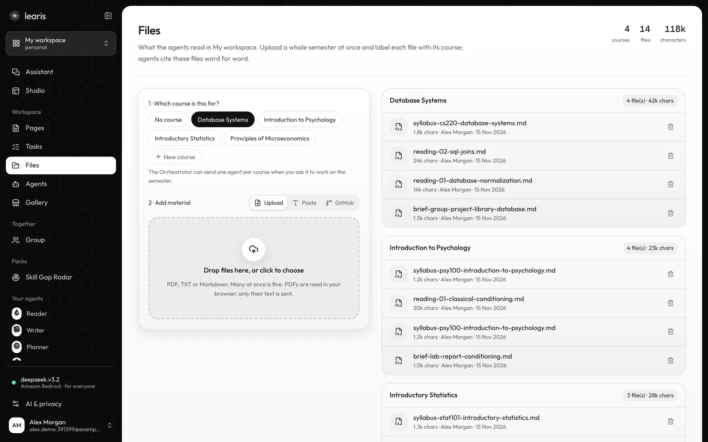</td>
<td width="50%"><b>Assistant</b>: one agent per course, every file read shown live<br/>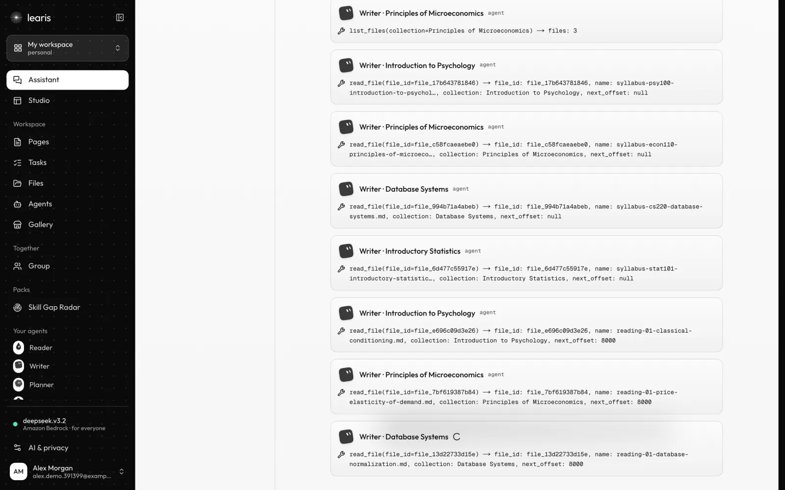</td>
</tr>
<tr>
<td><b>Page</b>: every claim numbered, each source an exact quote<br/>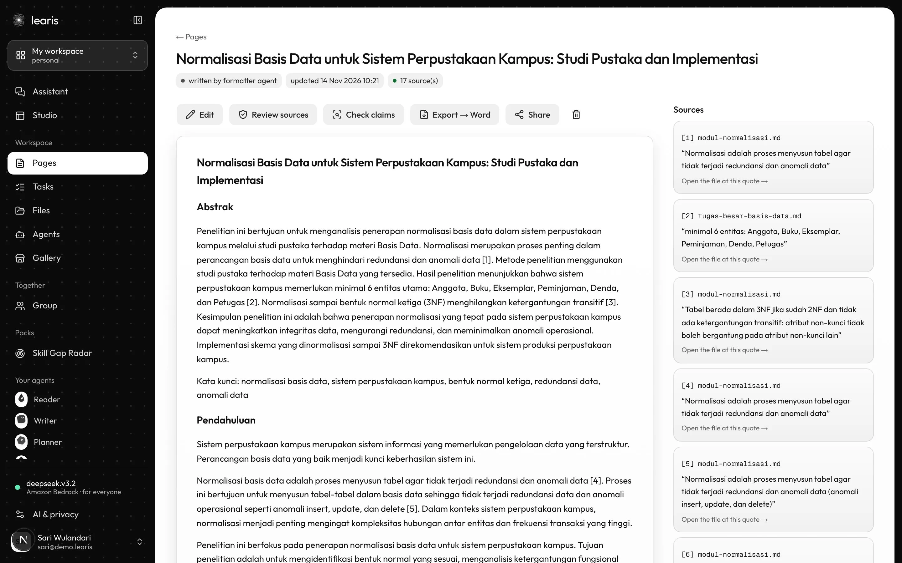</td>
<td><b>Tasks</b>: every deadline from the briefs, with its date<br/>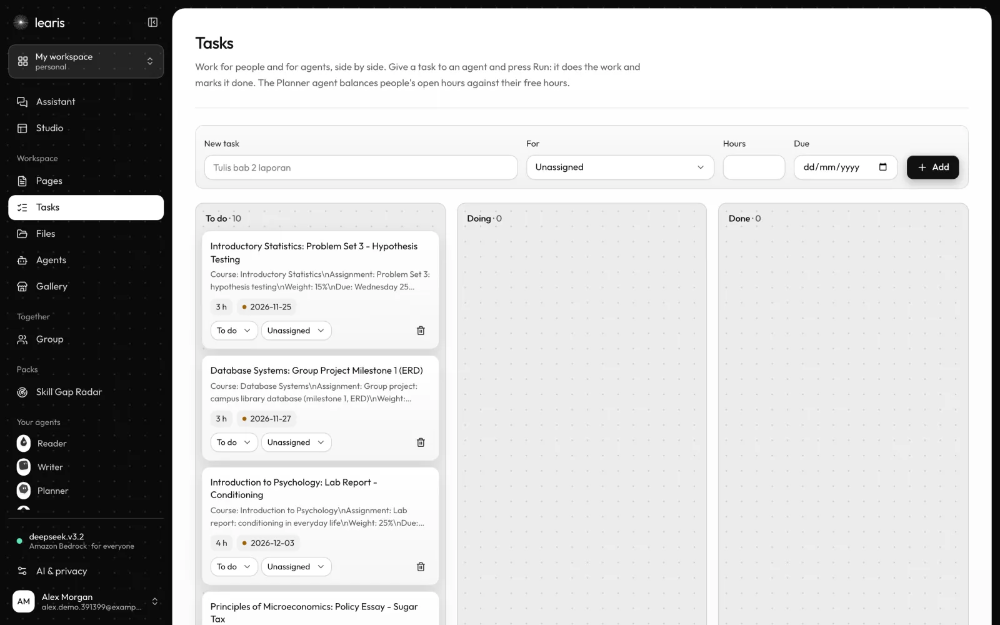</td>
</tr>
<tr>
<td><b>Share</b>: a public link, with WhatsApp, Telegram, X and LinkedIn<br/>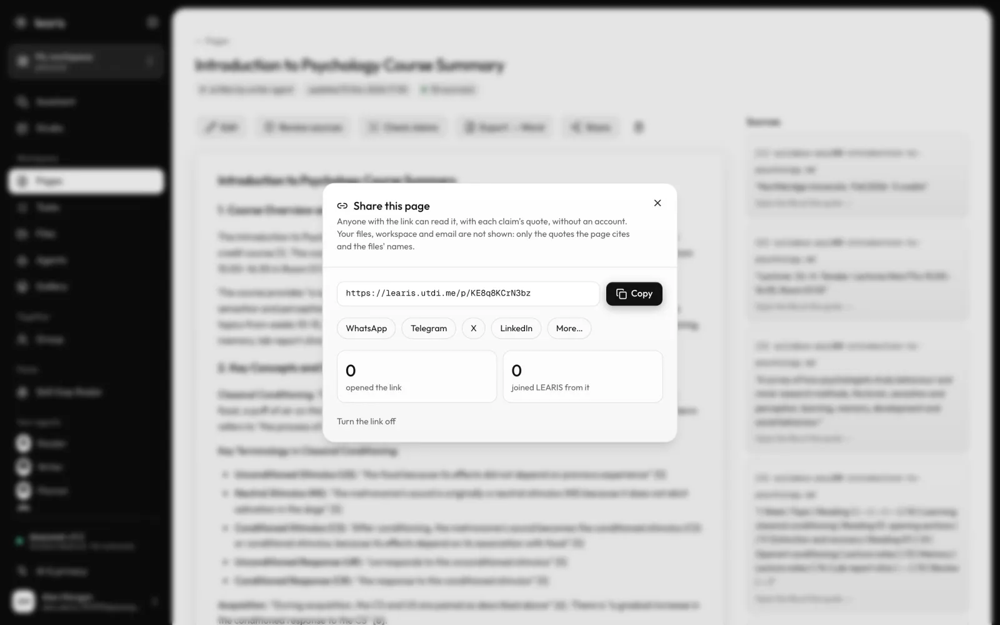</td>
<td><b>Public page</b>: readable without an account, quotes visible<br/>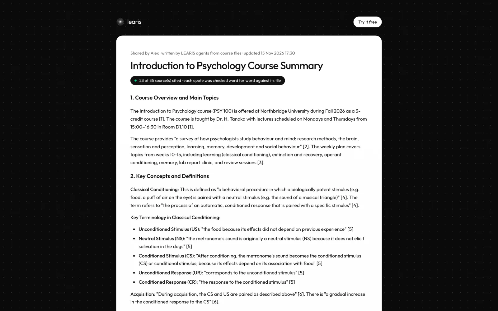</td>
</tr>
<tr>
<td><b>Your reach</b>: link opens and friends who joined, from our own database<br/>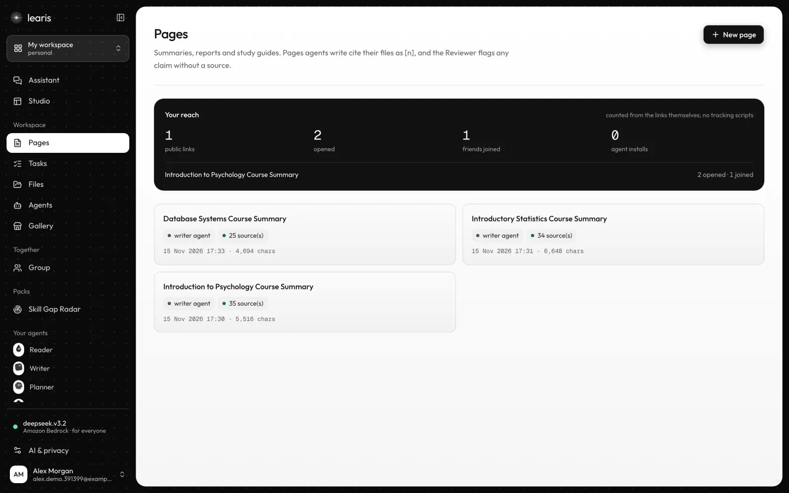</td>
<td><b>Studio</b>: up to four agents side by side, each with its own model<br/>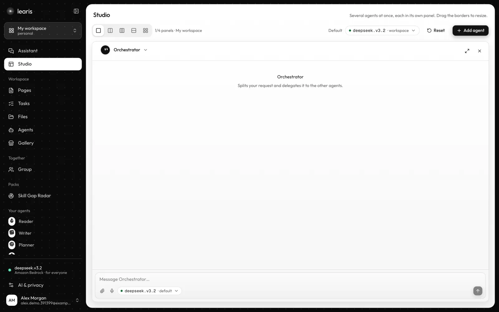</td>
</tr>
<tr>
<td><b>Agents</b>: the core team and the Academic pack<br/>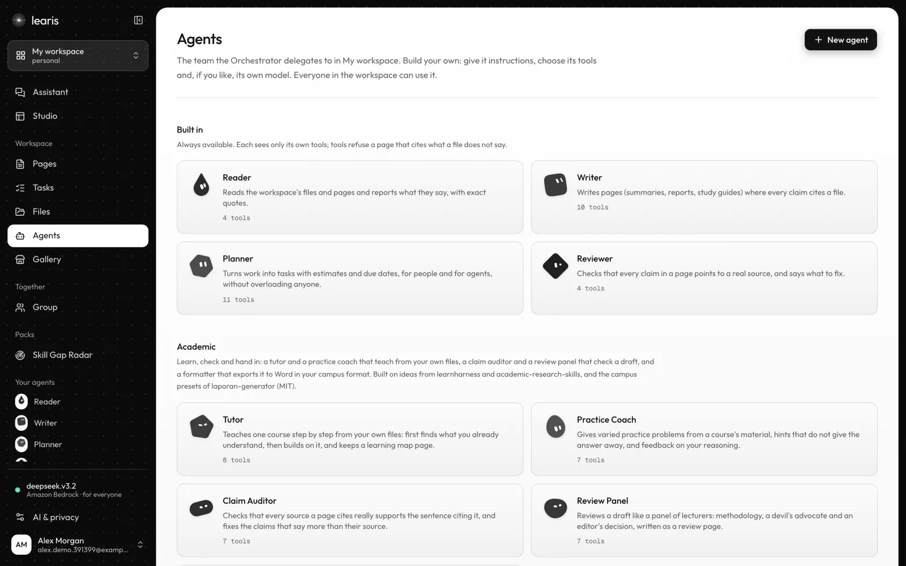</td>
<td><b>Gallery</b>: community agents, installed in one click<br/>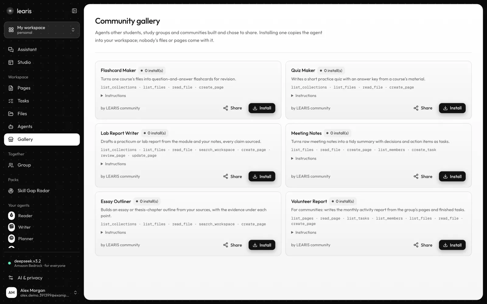</td>
</tr>
<tr>
<td><b>Group</b>: invite with a link, split work by free hours<br/>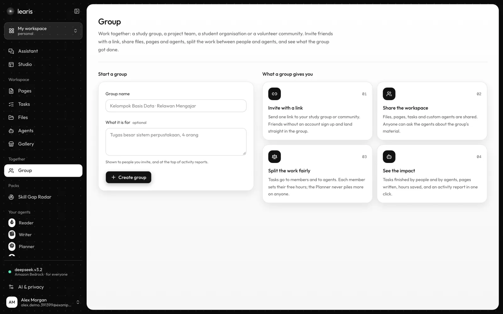</td>
<td><b>Skill Gap Radar</b>: proven skills, the gap to a role, a four-week plan<br/>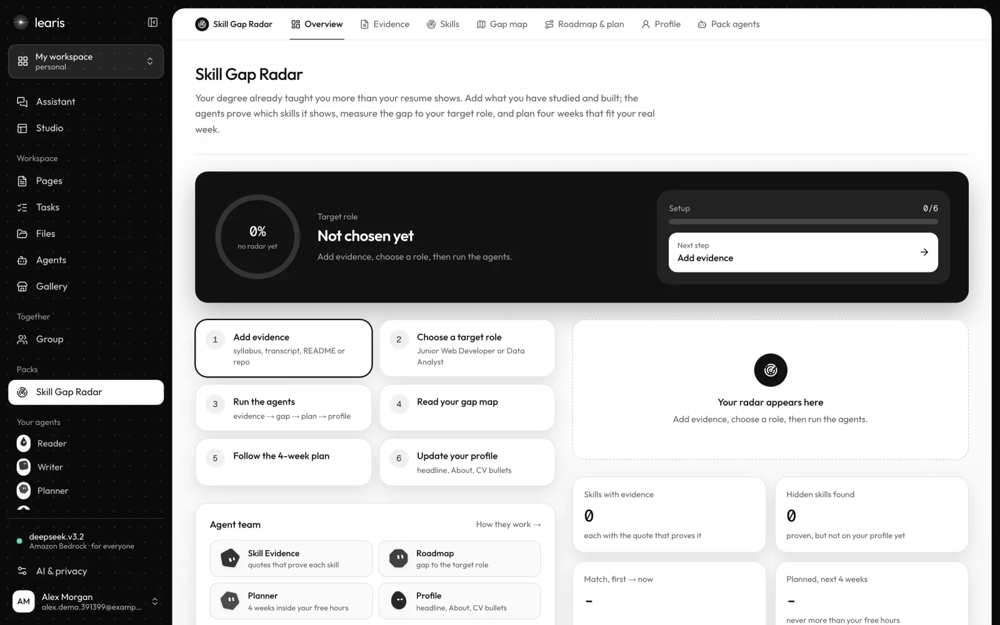</td>
</tr>
<tr>
<td colspan="2"><b>AI &amp; privacy</b>: bring your own model, consent before documents reach a model, delete everything<br/>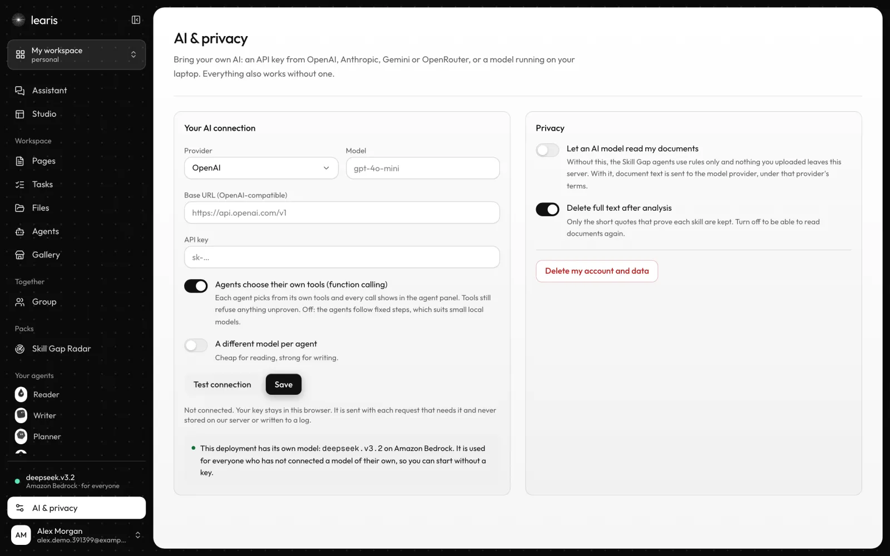</td>
</tr>
</table>

**On a phone, from a WhatsApp link:** the shared page, then sign-up with the sharer credited (`?ref=`).

<p>
  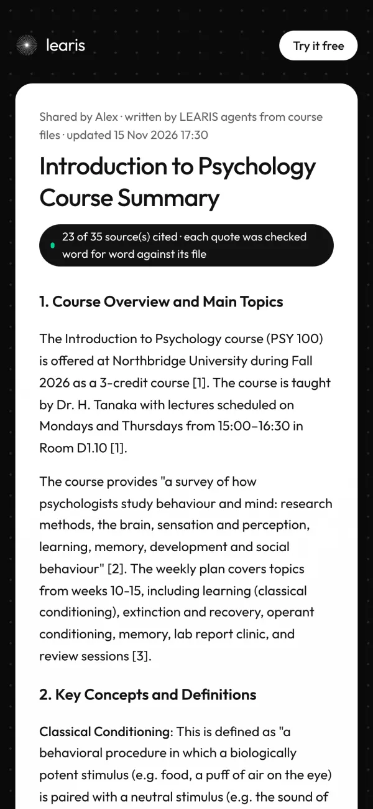
  &nbsp;
  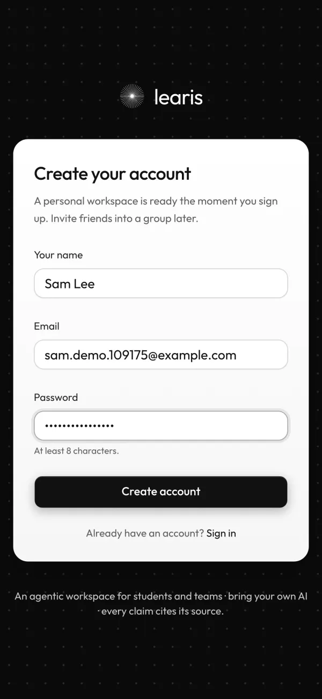
</p>

## The team

The Orchestrator (`agents/workspace.py`) reads the workspace and delegates one level deep, in parallel where it
can. Each agent sees only its own tools; tools that write check what they are given.

| Agent | Group | What it may do |
|---|---|---|
| **Orchestrator** | core | Reads the workspace overview, delegates to one or many agents at once, writes a closing summary that is fact-checked against what was made. Writes nothing itself. |
| **Reader** | core | Lists, reads and searches files and pages; answers with exact quotes. |
| **Writer** | core | Creates and updates pages where every claim cites a quote; runs the claim audit on its own drafts. |
| **Planner** | core | Reads every file's deadlines in one call (`find_deadlines`), creates tasks only with stated dates, assigns within members' free hours. |
| **Reviewer** | core | Checks that every `[n]` points to a real source and flags paragraphs with no source. |
| **Tutor** | Academic | Measure → plan → teach: diagnostic questions first, then one step at a time from your files, with a check question each step. |
| **Practice Coach** | Academic | Varied problems that make you recall which idea applies; progressive hints; feedback on reasoning. |
| **Claim Auditor** | Academic | Judges each quote: supported, partial or unsupported, with a reason; fixes all weak claims in one update. |
| **Review Panel** | Academic | A methods reviewer, a devil's advocate and an editor's decision (ready / minor / major revision) as a review page. |
| **Report Formatter** | Academic | Praktikum report, makalah, skripsi chapter, proposal or **journal paper** (Abstrak, Kata kunci, Pendahuluan, Metode, Hasil dan Pembahasan, Kesimpulan), checked against the structure before export. |
| **Skill Gap Radar** | pack | Its own team for skills evidence, the gap map, the plan and the profile text. |
| *custom* | yours | Your instructions and a chosen subset of tools; can be shared to the gallery. The gallery starts with six (Flashcard Maker, Quiz Maker, Lab Report Writer, Meeting Notes, Essay Outliner, Volunteer Report). |

## How it spreads

Students already pass notes and lab reports around class group chats. LEARIS makes the thing they pass along
carry its own proof and its own way in.

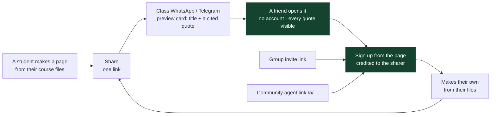

| Loop | What travels | Why someone acts on it |
|---|---|---|
| **Shared pages** (`/p/…`) | A summary, report or paper, readable without an account, each quote shown | Useful on its own (the friend gets the notes); the visible proof is the demo; "make one from your own files" is the next step. |
| **Group invites** | A link into a study group's workspace | Group work forces it: the shared files, board and fair split only work when everyone joins. |
| **Community agents** (`/a/…`) | An agent's instructions and tools, installable in one click | A course coach one student built is useful to the whole cohort; each install is credited to its author. |
| **Exports** | A Word report or journal paper in the campus format | The work a lecturer and classmates see; the next student asks how it was made. |

**Built so the loop is cheap to run:** bring-your-own-model (a new user costs almost nothing in AI), no install
(a web page that works on a phone), and value before sign-up (a shared page is useful to the reader at once).

**Measured, without tracking scripts.** Each link counts its own opens (link previews from chat apps are not
counted) and the sign-ups it brought in. `GET /reach` is one student's numbers; `GET /growth` is the whole loop:
accounts, the share of them that came through someone's link, by which kind of link, and sign-ups per sharing
student.

## Architecture

One web app and one agent service. The web app holds the session in an httpOnly cookie and forwards each request
with a signed token; the agent service checks workspace membership on every read and write, and **every claim an
agent writes goes through a tool that checks it** before it is stored.

### The system

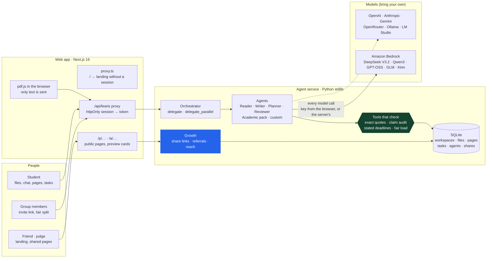

Green is where a rule holds whatever a model writes: the tools. Blue is the share loop.

### A request, end to end

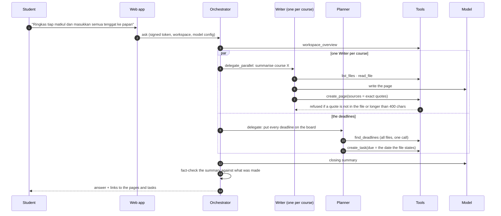

### One claim, end to end

```
Writer (on the model you picked)
  ├─ drafts a sentence and cites [n] with a quote from a file of this workspace
  ▼
check_sources(file_id, quote)                                        core/space.py
  │   the file belongs to this workspace (else 403)
  │   the quote is in the file, word for word, whitespace-insensitive (else refused)
  │   the quote is at most 400 characters: one passage proves one claim (else refused)
  ▼
page saved with sources [{n, file, quote}]
  ▼
Check claims / Claim Auditor                                         core/academic.py
  │   with a model: supported · partial · unsupported, with a reason, per claim
  │   without one:  word overlap plus standalone numbers (a plain rule check, labelled as such)
  │   unsupported → rewritten to what the quote proves, in one update_page; never strengthened
  ▼
Export → Word (14 formats) · Share → /p/<token> (quotes and file names only)
```

### The shape of the code

```
learis/agent/              the agent service, Python standard library only
  api.py · workspace_api.py   HTTP routes; every query scoped to a member; public routes for shared links
  agents/workspace.py         Orchestrator, core and Academic agents, custom agents, gallery, fact check
  agents/loop.py              the tool loop every agent runs (bounded rounds, nudge when it only announces)
  agents/team.py              the Skill Gap Radar pack
  tools/                      workspace tools (find_deadlines, audit_claims, report_doctor, …) and Skill Gap tools
  core/space.py               workspaces, members, invites, files, pages, tasks, impact, quote checks
  core/academic.py            claim audit, report doctor, campus and journal presets, stdlib DOCX writer
  core/growth.py              public share links, referrals, a student's reach, the product's loop
  core/ai.py · worker.py · jobs.py · identity.py · store.py   models, worker pool, schedule, tokens, SQLite
  mcp.py                      an MCP server for the Skill Gap tools
app/ · components/ · lib/  Next.js 16: landing (app/welcome), app pages, public /p and /a, share dialog
ops/                       server setup script, Compose deploy over SSH, CI/CD notes
```

## The categories, concretely

| Category | What to look at |
|---|---|
| **Business Success** | Share links and referral credit (`core/growth.py`: `share`, `public_page`, `record_signup`, `reach`, `loop`); public routes with no session (`workspace_api.py`: `/public/page/…`, `/public/agent/…`); the share dialog with WhatsApp, Telegram, X and LinkedIn targets (`components/share.tsx`); preview cards (`app/p/[token]/opengraph-image.tsx`); bring-your-own-model with the key kept in the browser (`lib/ai-config.ts`, `components/model-picker.tsx`). |
| **World Impact** | Quote checks (`core/space.py: check_sources`, `MAX_QUOTE`); the claim audit and its rule fallback (`core/academic.py: audit`); deadlines only with stated dates (`tools/workspace_tools.py: find_deadlines`); fair load in groups (`_check_load`); the Orchestrator's fact check (`agents/workspace.py: _overclaims`); Tutor and Practice Coach instructions; voice (`components/voice.tsx`); consent and account deletion (`api.py: delete_me`). |
| **Real-world success** | `GET /growth` (accounts, referred share, by link kind, k-factor) and `GET /reach`, counted from the `shares` and `referrals` tables; no third-party analytics. |

## Run it

```bash
cd learis/agent
PYTHONPATH=. python3 manage.py check     # 23 offline self-checks
export LEARIS_SECRET="$(python3 -c 'import secrets; print(secrets.token_hex(32))')"
PYTHONPATH=. python3 manage.py seed      # optional: demo account sari@demo.learis / demo12345
PYTHONPATH=. python3 api.py              # :8787 (Python 3.9+, standard library only)

# repo root, another terminal
npm install
LEARIS_API=http://127.0.0.1:8787 npm run dev   # :3000
```

Sign in, choose a model from the chip under the chat box (or connect one in **AI & privacy**), add files, and
ask. To give everyone a model without a key, put an Amazon Bedrock API key in
`learis/agent/.secrets/bedrock.env` as `AWS_BEARER_TOKEN_BEDROCK=…` (gitignored).

`docker compose up` runs both services. Deploying to a fresh Ubuntu server: paste `ops/server-setup.sh` into the
instance's user data (Docker, nginx for the web and the API, swap, `.env`), point DNS, run certbot, and every push
to `main` deploys through GitHub Actions ([`ops/CICD.md`](ops/CICD.md)).

## Try it in five minutes

1. Open [learis.utdi.me](https://learis.utdi.me) → **Start free** → create an account.
2. **Files**: upload a few course files (PDF, TXT or Markdown), pick a course for them.
3. **Assistant**: *"Ringkas tiap mata kuliah di Files, satu halaman per matkul, dan masukkan semua tenggat ke
   papan."* Watch the agents work, one per course.
4. **Tasks**: every deadline with its date. **Pages**: open one and click a `[n]`; the file opens at the quote.
5. **Check claims**, then ask the **Claim Auditor** to fix what it flags. **Export → Word** in a journal format.
6. **Share** the page, open the link in a private window (no account, every quote shown), sign up from it, and
   see the sign-up counted on **Pages → Your reach**.

## What is verified, and what is not yet

| | Status |
|---|---|
| Agent service | 23 offline self-checks (`manage.py check`): engines, tools, swarm, academic, growth, workers, MCP, API |
| End to end, real model (Bedrock, DeepSeek V3.2) | 80 / 81 on a semester of 4 courses and 10 files plus adversarial files: semester flow, multi-turn chat, attachments, agents, tasks, gallery, groups, access control, limits, BYOK, account deletion |
| Academic pack, live | 25 / 27 (both misses were the wording of an opening question, since tightened) |
| Deadlines | 5 / 5 found with exact dates, none invented |
| Claim Auditor | Caught and fixed an inflated claim (2 / 0 / 1 → 3 / 0 / 0 supported / partial / unsupported) |
| Prompt injection in an uploaded file | Ignored; nothing deleted, the real summary returned |
| Access control | Another user's workspace, files and group: 403 everywhere; forged or deleted-account tokens: 401 |
| Share loop | Link opened without an account, preview card, sign-up through the link credited, link turned off → 404, nothing private in the public view |
| Live deploy | [learis.utdi.me](https://learis.utdi.me): Docker Compose on AWS EC2 behind nginx with Let's Encrypt; CI runs lint, typecheck, unit tests, build, self-checks and deploy-script tests on every push |
| Web app | `npm run lint`, `npx tsc --noEmit`, `npm test`, `npm run build`; landing checked at 1440 px and 390 px with no horizontal scroll, and static under reduced motion |
| Not yet measured | Real-world growth numbers: the loop is instrumented, the first public sharing starts with the finals |
| Not yet built | Paid plans (Pro, Campus) are planned, not implemented |

## Layout

| Path | |
|---|---|
| `learis/agent/` | Python agent service, standard library only: API, agents, tools, academic engines, growth, SQLite |
| `app/(app)/` | The app: Assistant, Studio, Files, Pages, Tasks, Agents, Gallery, Group, Settings, Skill Gap |
| `app/welcome/` | The landing page (Lenis smooth scroll, GSAP scroll scenes, interactive claim check) |
| `app/p/` · `app/a/` | Public shared page and agent, with preview cards |
| `components/` | Chat, Studio, model picker, attachments, file preview, academic (claim check, Word export), share, voice |
| `ops/` | `server-setup.sh`, `deploy-docker-ssh.sh` and its tests, `CICD.md` |
| `learis/PROJECT-CONTEXT.md` | Decisions and the status of every feature |

## Credits and originality

LEARIS is our own work. It grew from our earlier Skill Gap Radar engine (kept as a pack) and reuses the UI shell of
our earlier project AERA. Ideas from three open projects shaped the Academic pack, re-implemented by us:

- [academic-research-skills](https://github.com/imbad0202/academic-research-skills) (CC BY-NC 4.0): claim-level citation audits and a reviewer panel. **Idea only, no content copied.**
- [learnharness](https://github.com/amosblomqvist/learnharness) (AGPL-3.0): measure → plan → teach → practise for the Tutor and Practice Coach. **Idea only, no code copied.**
- [laporan-generator](https://github.com/muadzhdz/laporan-generator) (MIT, © Mu'adz Hudzaifah): the campus and journal **preset values** (margins, numbering, cover rules) used by our own DOCX writer.

**Libraries:** none in the agent service; the web app's are in `package.json`.
**AI-generated code:** much of this repository was written with AI coding assistants, reviewed and tested by the team.

## License

MIT, see [`LICENSE`](LICENSE).
